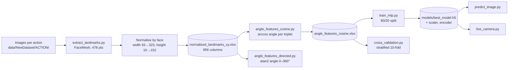

# Face Liveness Detection: Landmark-Angle Action Classifier

> Script-based research pipeline that recognises which facial action a person is performing (smile, pout, eyes closed, show teeth…) from geometry-invariant **angles between MediaPipe FaceMesh landmarks**, as the verification step of a random-action liveness challenge.


> [!NOTE]
> This is the earlier, script-based version of the work. The curated repository with the in-browser random-action liveness demo (MediaPipe blendshapes) and the landmark / blendshape datasets is **[Face-Liveness-Detection](https://github.com/rupeshbharambe24/Face-Liveness-Detection)**.

## Contents

- [Overview](#overview)
- [Pipeline](#pipeline)
- [Angle features](#angle-features)
- [Classifier and cross-validation](#classifier-and-cross-validation)
- [Project structure](#project-structure)
- [Getting started](#getting-started)
- [Status and limitations](#status-and-limitations)
- [Related repositories](#related-repositories)
- [License](#license)

## Overview

A random-action liveness check asks the user to perform actions picked at random ("smile", then "close your eyes"…) and passes only if each one is seen on camera. A printed photo or a replayed video cannot follow an unpredictable sequence. The hard part is the verifier: deciding reliably which action the face is performing, independent of face size, position and in-plane rotation.

This repository attacks that with hand-designed geometry rather than raw pixels or raw coordinates:

1. Detect 478 FaceMesh landmarks (468 face + 10 iris) per image.
2. Normalise them to the face's own width and height.
3. For a fixed list of landmark **triplets** around the mouth, eyes, brows, cheeks, nose and irises, compute the angle at the middle landmark.
4. Train a small regularised MLP on the angle vector, and evaluate it with stratified k-fold cross-validation.

Actions targeted by the scripts: `Smile`, `Pout`, `Open_Mouth`, `Show_Teeth`, `Eyes_Close`, `Inward_Lip_Press`, `Neutral` (later additions: `Brow_Raise`, `Surprise`, `Nose_Wrinkle`, `Cheek_Puffing`).

## Pipeline



## Angle features

**Normalisation.** With landmarks 93 / 323 (left / right cheek) giving the face width and 10 / 152 (forehead top / chin) the face height, every landmark becomes

```
x' = (x − x₉₃) / |x₃₂₃ − x₉₃|        y' = (y − y₁₀) / |y₁₅₂ − y₁₀|
```

which removes translation and face scale.

**Triplet angles.** For a triplet `(A, B, C)` the feature is the angle at vertex `B` between vectors `BA` and `BC`:

```
θ = arccos( (BA · BC) / (‖BA‖ ‖BC‖) )          # angle_features_cosine.py, 0–180°
θ = atan2(BC) − atan2(BA)  mapped to [0, 360)  # angle_features_directed.py, keeps orientation
```

Angles do not change under uniform scaling or in-plane rotation, and they capture shape changes directly: a smile widens the angles at the mouth corners (61, 291), closed eyes collapse the eyelid triangles (33-159-145, 362-386-374), raised brows open the brow-to-eye angles (105-70, 334-300). The triplet list has 141 entries (139 unique) over 96 distinct landmarks, including the iris points 469–477. The directed version also drops duplicate feature columns.

## Classifier and cross-validation

| | `train_mlp.py` | `cross_validation.py` |
|---|---|---|
| Input | `data/angle_features_cosine.xlsx` | same |
| Preprocessing | `LabelEncoder`, `StandardScaler` (a PCA at 95 % variance is fitted and saved but not used for training) | same |
| Network | Dense 32 (ReLU, L2 1e-3) → BatchNorm → Dropout 0.4 → Dense 16 → BatchNorm → Dropout 0.3 → softmax | Dense 32 → BN → Dropout 0.5 → Dense 16 → BN → Dropout 0.4 → softmax |
| Optimiser | Adam, lr 5e-4, batch 32, 500 epochs | Adam, lr 7e-4, batch 32, 500 epochs |
| Validation | stratified 80/20 split, best epoch by `val_accuracy` | `StratifiedKFold(n_splits=10, shuffle=True, random_state=42)`, best checkpoint per fold |
| Outputs | `models/best_model.h5`, `models/model_with_scaler_and_encoder.pkl`, classification report, confusion matrix | per-fold reports and confusion matrices, average normalised confusion matrix, mean ± std accuracy → `models/cv/cross_validation_results.pkl` |

The training scripts also contain a label mapping for the JAFFE facial-expression codes (`FE, SA, HA, NE, AN, SU, DI`), because the same feature pipeline was tried on emotion recognition.

**Results.** No accuracy figures, plots or logs were saved in this repository, so none are quoted here. Run `cross_validation.py` on your own data to get the mean and standard deviation across folds.

## Project structure

```text
Real-Time-Face-Liveness-Detection-using-Random-Facial-Actions/
├── src/
│   ├── extract_landmarks.py        # step 1: images → normalised landmarks (Excel)
│   ├── angle_features_cosine.py    # step 2: landmarks → arccos triplet angles (used for training)
│   ├── angle_features_directed.py  # step 2 (alt): landmarks → directed 0–360° angles
│   ├── train_mlp.py                # step 3: train + evaluate MLP, save model/scaler/encoder
│   ├── cross_validation.py         # step 4: stratified 10-fold evaluation
│   ├── predict_image.py            # classify one image
│   └── live_camera.py              # classify webcam frames
├── requirements.txt
└── LICENSE
```

`data/` (images and generated spreadsheets) and `models/` are created locally and git-ignored.

## Getting started

```bash
git clone https://github.com/rupeshbharambe24/Real-Time-Face-Liveness-Detection-using-Random-Facial-Actions.git
cd Real-Time-Face-Liveness-Detection-using-Random-Facial-Actions
python -m venv .venv && source .venv/bin/activate
pip install -r requirements.txt
```

Put images in one folder per action (`data/NewDataset/Smile/*.jpg`, `data/NewDataset/Pout/*.jpg`, …), then run from the repo root:

```bash
python src/extract_landmarks.py        # → data/normalized_landmarks_xy.xlsx
python src/angle_features_cosine.py    # → data/angle_features_cosine.xlsx
python src/train_mlp.py                # → models/best_model.h5, models/model_with_scaler_and_encoder.pkl
python src/cross_validation.py         # 10-fold evaluation
python src/predict_image.py path/to/face.jpg
python src/live_camera.py              # Esc to quit
```

## Status and limitations

- **Research code, not a finished liveness system.** `live_camera.py` classifies each webcam frame (about one per second) and overlays the predicted action; it does not issue random prompts or keep a pass/fail state. The random-challenge flow is implemented in the browser version in [Face-Liveness-Detection](https://github.com/rupeshbharambe24/Face-Liveness-Detection).
- The landmark spreadsheets, images and trained weights are not included.
- An action classifier on its own does not defend against replayed video of a person performing every action, or against 3D masks; it is one layer of a liveness check.
- The triplet list was built up by hand and contains a few duplicates; feature selection was not studied systematically.

## Related repositories

| Repository | Role |
|---|---|
| [Face-Liveness-Detection](https://github.com/rupeshbharambe24/Face-Liveness-Detection) | Curated version: in-browser random-action check with MediaPipe blendshapes, landmark MLP notebook, preprocessing scripts and datasets |
| **Real-Time-Face-Liveness-Detection-using-Random-Facial-Actions** (this repo) | Script pipeline for landmark-angle features, MLP training and k-fold evaluation |

## License

[MIT](LICENSE)
